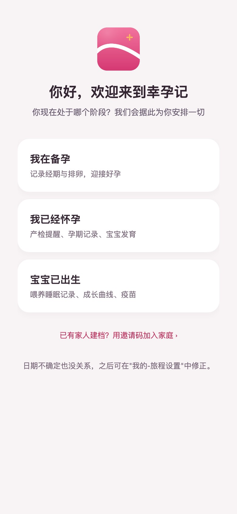
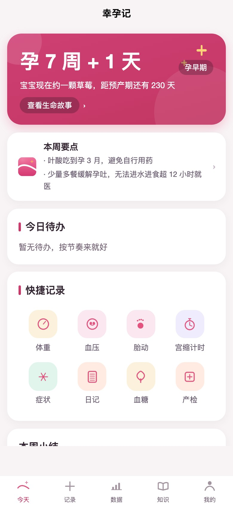
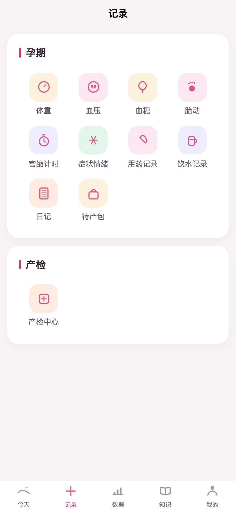
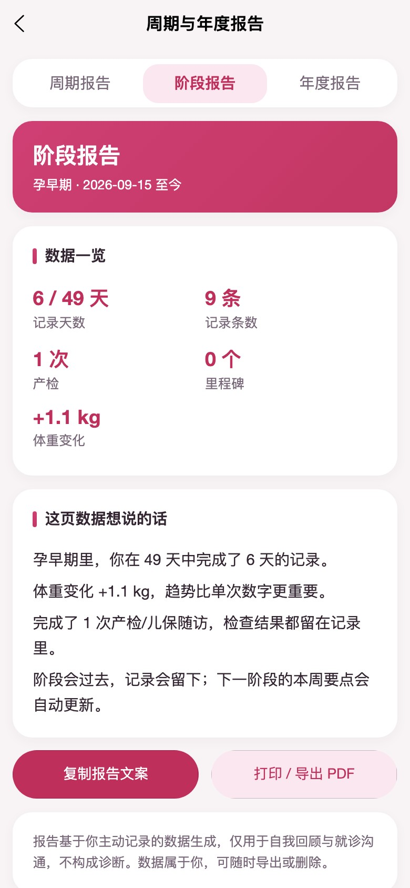
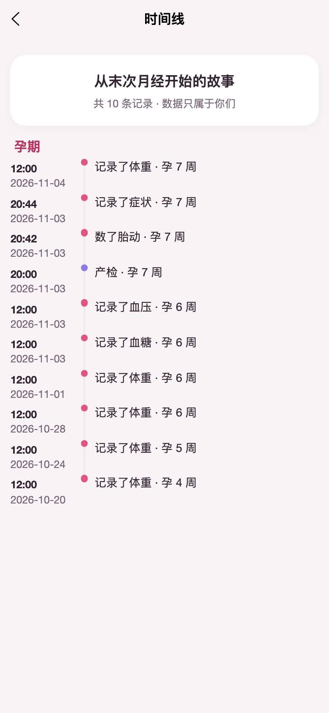
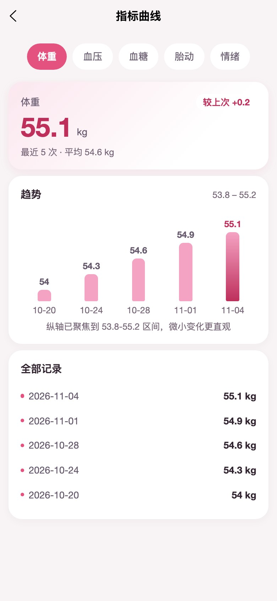
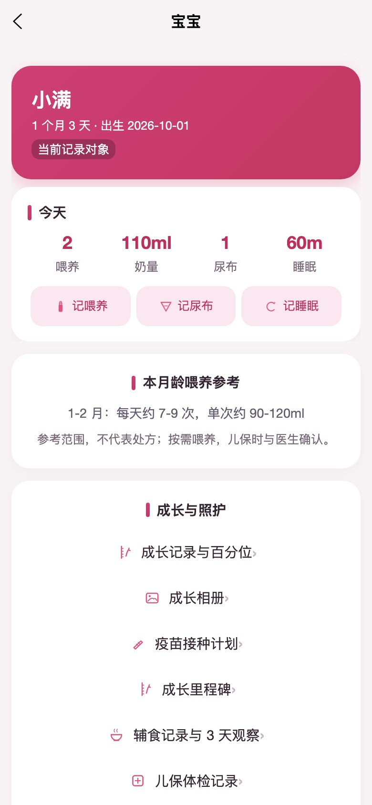
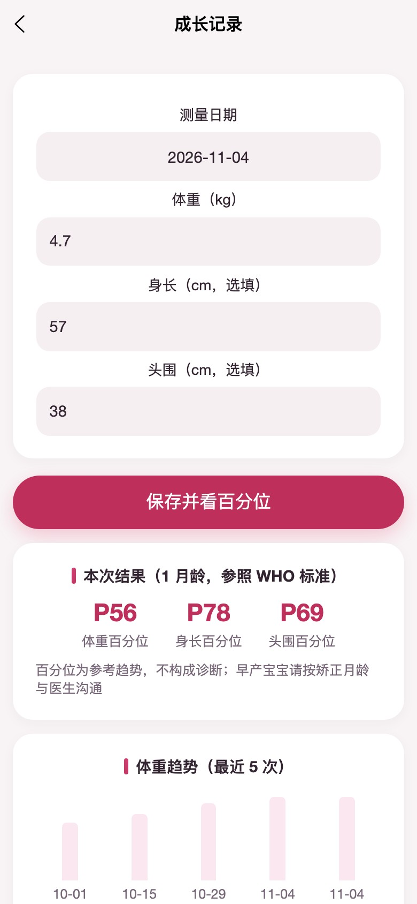
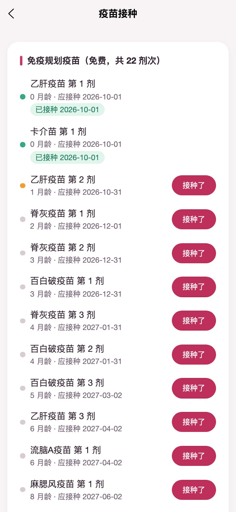

English · **[简体中文](README.md)**

<div align="center">
  
  <h1>Lucky Bump</h1>
  <p><strong>One unbroken record, from trying to conceive to toddlerhood.</strong></p>
  <p>A full-cycle family health journal covering “trying to conceive → first/second/third trimester → birth → confinement → postpartum recovery → parenting ages 0-3”.</p>

  <p>
    
    
    
    
    
  </p>
</div>

---

## Why Lucky Bump

Most pregnancy apps cover only the pregnancy itself, or split conception, pregnancy and parenting into products that cannot talk to each other. Lucky Bump joins that timeline into one journey: **one record, one dataset, one privacy boundary**, from the first day of the last menstrual period until the child turns three.

- **No gap between stages**: cycle history, prenatal checkups, fetal movement, birth, lochia, feeding, sleep, growth, vaccines and milestones all live on a single timeline. Changing stage does not mean changing apps or migrating data.
- **Family collaboration without overreach**: partners and grandparents join through an invite code and get a role of recorder or read-only viewer. Intercourse, pregnancy-test and EPDS records are hard-coded as owner-only and cannot be granted away.
- **The data belongs to the user**: full structured JSON export, a human-readable summary, print/PDF and CSV. Account deletion has a 30-day cooling-off period that can be cancelled at any time, after which cloud data is physically purged.
- **A restrained medical boundary**: no diagnosis and no dosage advice. Abnormal values only describe the observation and prompt a visit to a clinician; every red-flag hint and scale result is labelled “not a diagnosis”.
- **Offline first**: writes made on a weak or absent connection queue locally and replay with idempotent client IDs once the network returns, without losing or duplicating records.

## Screens

<table>
  <tr>
    <td align="center"><br/><sub><b>One setup, three stages</b></sub></td>
    <td align="center"><br/><sub><b>Gestational age, baby size, this week</b></sub></td>
    <td align="center"><br/><sub><b>Record entries scoped to the stage</b></sub></td>
  </tr>
  <tr>
    <td align="center"><br/><sub><b>Stage report: data told as a story</b></sub></td>
    <td align="center"><br/><sub><b>One unbroken life timeline</b></sub></td>
    <td align="center"><br/><sub><b>Weight, blood pressure, glucose, movement, mood</b></sub></td>
  </tr>
  <tr>
    <td align="center"><br/><sub><b>Baby care and today’s summary</b></sub></td>
    <td align="center"><br/><sub><b>WHO growth percentile reference</b></sub></td>
    <td align="center"><br/><sub><b>Immunization schedule and records</b></sub></td>
  </tr>
</table>

## Feature map

| Stage | Core capabilities |
|---|---|
| **Trying to conceive** | Period calendar and cycle prediction, ovulation tests, basal body temperature, intercourse/discharge/pregnancy-test logs, cycle reports and regularity analysis |
| **Pregnancy** | Gestational age and baby size, weekly highlights, weight/blood pressure/glucose/fetal movement/contraction timer, symptoms and mood, prenatal schedule and visit records, hospital bag, stage reports |
| **Birth and postpartum** | Delivery registration and birth card, multiples, confinement clock, lochia, nursing timer, EPDS postpartum self-assessment, postpartum follow-ups |
| **Parenting 0-3** | Feeding (breast/bottle/formula), diapers, sleep, growth percentiles, vaccine plan, milestones, photo album, 3-day food observation, well-child checkups |
| **Family and data** | Family invites and permission matrix, access audit log, timeline, cycle/stage/annual reports, JSON export, readable summary, CSV, print/PDF |
| **Security and compliance** | Separate consent for sensitive data, app lock, account recovery, deletion cooling-off with cancellation, strict data groups, clientDB disabled |

## Architecture

```
┌──────────────────────────────────────────────┐
│  uni-app x (vapor / UTS / .uvue)             │
│  Android · iOS · Web                         │
│  54 pages · custom design system · offline   │
└──────────────────────┬───────────────────────┘
                       │ cloud object RPC (token guard + uniform errors)
┌──────────────────────▼───────────────────────┐
│  uniCloud · Alipay Cloud                     │
│  12 cloud functions / objects                │
│  31 collection schemas · 30 indexes          │
│  clientDB fully disabled, access via objects │
└──────────────────────┬───────────────────────┘
                       │
┌──────────────────────▼───────────────────────┐
│  Node built-in test runner + in-memory uniCloud │
│  160 tests: auth / isolation / state / export│
└──────────────────────────────────────────────┘
```

- **Frontend**: [uni-app x](https://doc.dcloud.net.cn/uni-app-x/) (`.uvue` + UTS, vapor bytecode rendering, native Android/iOS, the same codebase also runs on the web).
- **Backend**: uniCloud on Alipay Cloud; cloud objects carry all business logic. `uni-id-users` follows the official uni-id structure, so the project can migrate to `uni-id-pages-x`.
- **Data safety**: clientDB read/write is `false` on every schema; intercourse, pregnancy-test and EPDS records are filtered server-side, so family members and admins cannot read them regardless of role.
- **Testability**: cloud objects have zero third-party dependencies, and tests drive the real business code through an in-memory uniCloud runtime instead of mocking logic.

## Getting started

```bash
npm install        # no required third-party deps; tests use the Node built-in runner
npm test           # all 160 tests
npm run test:unit  # unit tests
npm run test:e2e   # end-to-end lifecycle tests
npm run schemas    # regenerate database schemas
npm run indexes    # regenerate index files
```

**Running the app / web build**: open the project root in HBuilderX, then follow [docs/08-部署与上线指南](docs/08-部署与上线指南.md) (Chinese) to link a uniCloud space, upload the cloud functions and initialize the database. Run on Android/iOS or publish to web from the same IDE.

> Web photo uploads need the frontend origin (including port) added to the Alipay Cloud console under CORS / web security domains. Native apps are not subject to browser CORS.
>
> The cloud space binding lives in `uniCloud-alipay/spacex.json`, which is gitignored; a template is provided in `spacex.example.json`.

## Security design

- **Every read and write goes through cloud objects**: clientDB is fully disabled, so the frontend cannot reach the database directly. Each method runs `auth.requireUser` to validate the token signature, its revocation state and the session uid.
- **Fail-closed secrets**: `tokenSecret` is only read from `uni-config-center`. If it is missing or still the example placeholder in production, startup is refused rather than falling back to the public development key.
- **Authorization checks**: every read method taking a `journeyId` verifies journey ownership; the family permission matrix for checkups, reports, emotions and diaries is enforced server-side; intercourse, pregnancy-test and EPDS records only ever return the caller’s own rows.
- **Rate limiting on anonymous endpoints**: registration, SMS, login, password recovery and deletion cancellation are limited per IP and per account, with a bucket cap to prevent memory exhaustion.
- **Revocable sessions**: logout, password change, recovery and deletion requests revoke the affected tokens. Tokens are bound to their `lb-token` session row, so a token cannot be reused for another account.

> Rate limiting uses in-memory counters per instance, so on a multi-instance deployment the effective threshold scales with the instance count. Move the counters to Redis or the database if you need a hard limit (see the known limitations in docs/08).

## Project layout

```
├── pages/                 # 54 .uvue pages (account, onboarding, today, records, care, baby, data, learn, me)
├── components/lbc-*       # design-system components (easycom)
├── store/ utils/          # state, cloud-object RPC, offline queue, dates and notifications
├── uniCloud-alipay/       # Alipay Cloud service space
│   ├── cloudfunctions/    # 12 cloud functions/objects + shared modules
│   └── database/          # 31 collection schemas + 30 indexes
├── test/                  # in-memory uniCloud runtime + unit/E2E tests
├── scripts/               # icon, schema, index and release-check scripts
├── docs/                  # product, technical, deployment and release docs (Chinese)
└── nativeResources/       # iOS privacy manifest and other native assets
```

## Privacy and compliance

- **Separate consent**: sensitive personal information (health data) is explicitly opted in on the registration screen and persisted immediately; onboarding does not ask again. Older accounts are covered by a consent gate on the home screen.
- **Strict data groups**: intercourse, pregnancy-test and EPDS records are hard-coded owner-only on the server. No family grant and no admin role can override that.
- **Data rights**: full export, readable summary, CSV and print/PDF are supported. Deletion enters a 30-day cooling-off period, can be cancelled, and is physically purged by a scheduled task afterwards.
- **Audit trail**: owners can see when family members opened their data pages. The owner’s own actions are not logged, to avoid creating new privacy noise.
- **Medical boundary**: this product is not a medical device and does not provide diagnosis, treatment or dosage advice. All hints exist only to support record-keeping and conversations with a clinician.

## Documentation

> Product and technical documents are currently written in Chinese.

| Area | Documents |
|---|---|
| Product | [01-Requirements](docs/01-需求分析报告.md) · [02-Positioning and architecture](docs/02-产品定位与功能架构.md) · [03-Feature design](docs/03-核心功能详细设计.md) · [04-Data model](docs/04-数据模型与页面结构.md) |
| Technical | [06-Architecture](docs/06-技术架构设计.md) · [07-UI design system](docs/07-UI设计系统.md) · [08-Deployment guide](docs/08-部署与上线指南.md) |
| Specific topics | [10-HBuilderX platform defects](docs/10-HBuilderX平台缺陷报告.md) · [11-External dependencies](docs/11-外部依赖与接入清单.md) · [12-Pre-release checklist](docs/12-上线前定版与发布清单.md) · [13-Store listing copy](docs/13-商店上架文案与素材清单.md) |
| Process | [DEV-PROGRESS](docs/DEV-PROGRESS.md) |

## Roadmap

- **v1.1**: line-chart component, packaged media export, server push, more pregnancy and parenting content
- **Later**: additional languages, multiple concurrent family journeys, controlled integrations with wearables and hospital systems

> Recording stays free forever. No third-party splash ads. No diagnosis.

## License

Released under the [MIT License](LICENSE). Medical and privacy copy, third-party chart conventions and trademarks are outside the license scope.

---

<div align="center">
  <sub>Lucky Bump · One unbroken record, from trying to conceive to toddlerhood</sub>
</div>
