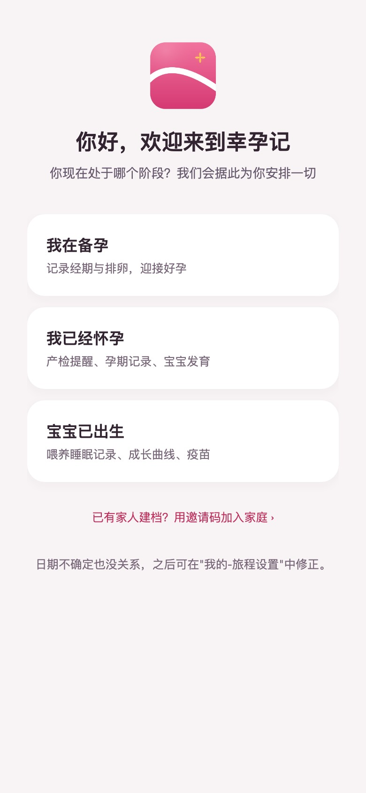
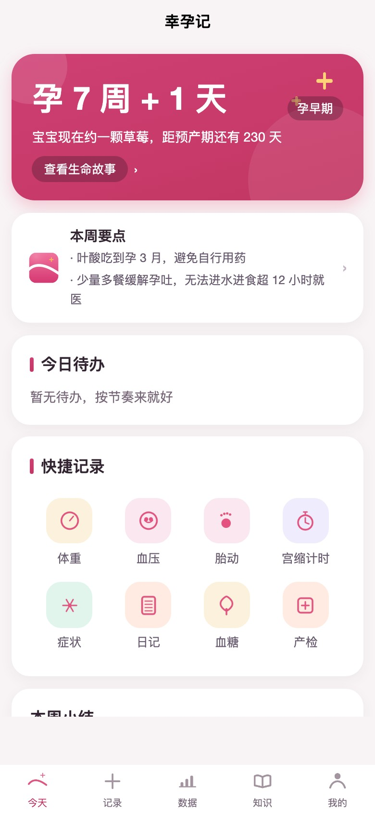
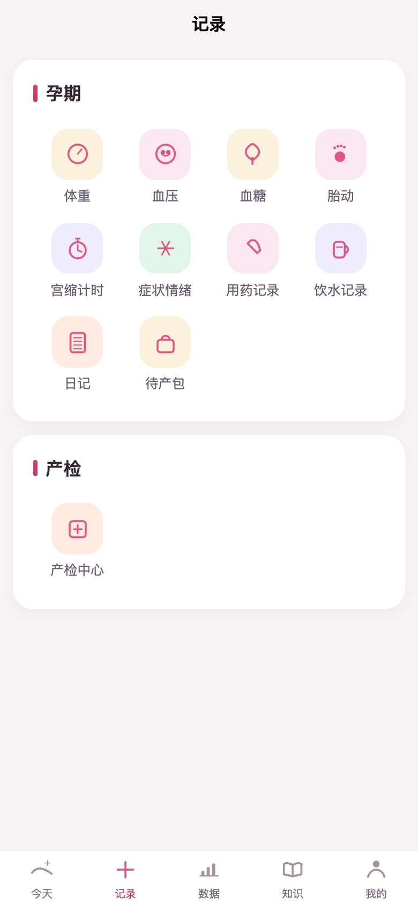
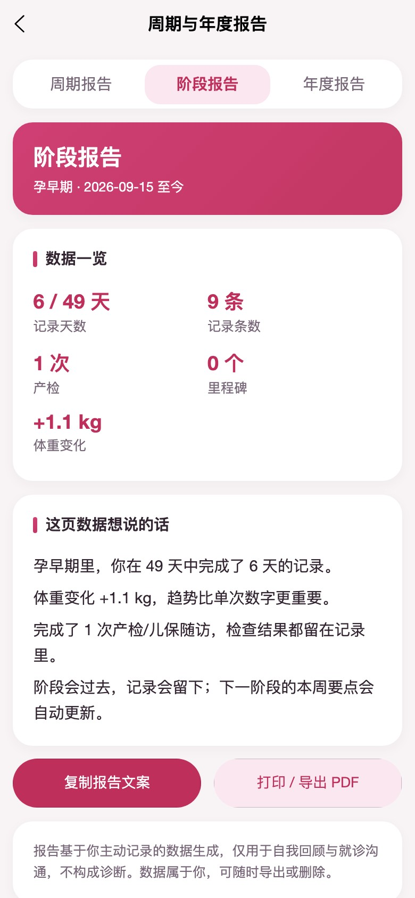
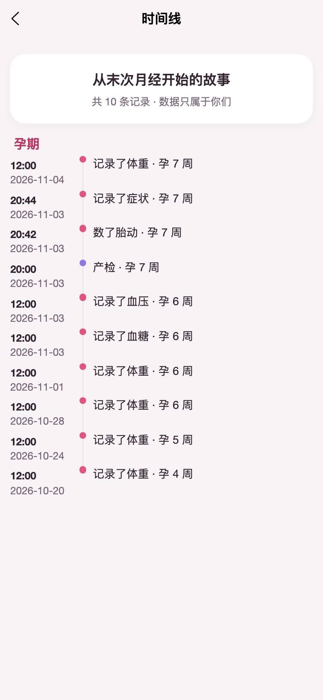
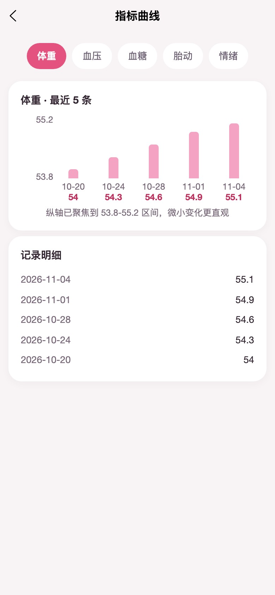
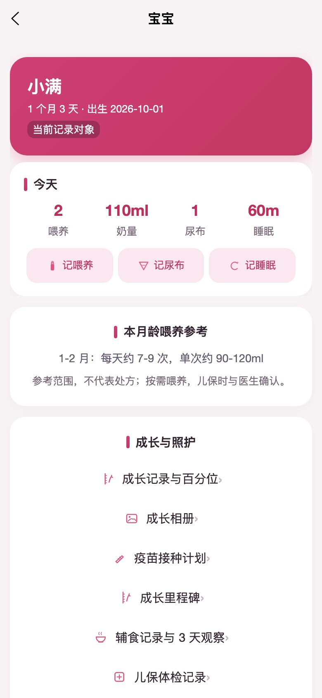
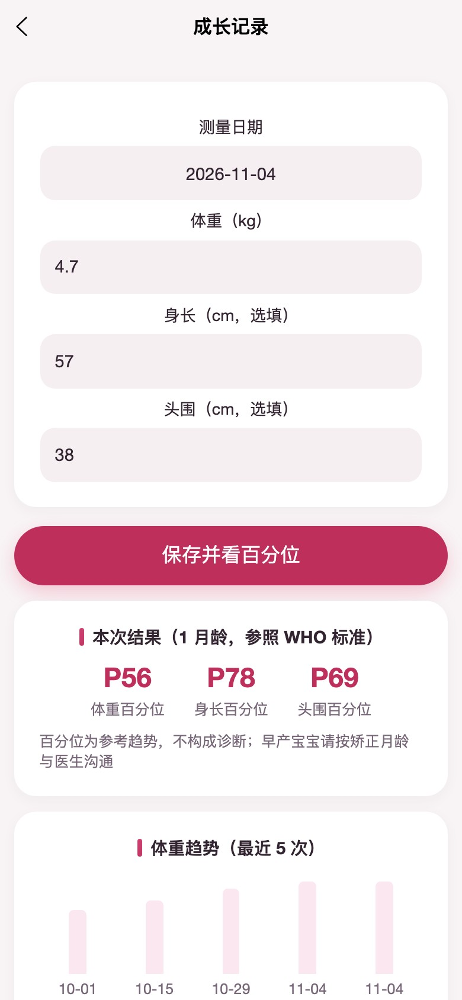
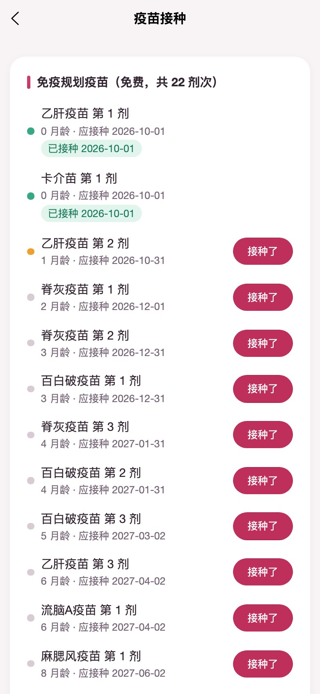

<div align="center">
  
  <h1>幸孕记 Lucky Bump</h1>
  <p><strong>从备孕到育儿，一条不断档的生命记录。</strong></p>
  <p>覆盖「备孕 → 孕早/中/晚期 → 分娩 → 产褥期 → 产后恢复 → 0-3 岁育儿」的全周期家庭健康记录 App。</p>

  <p>
    
    
    
    
    
  </p>
</div>

---

## 为什么是幸孕记

大多数孕产 App 只覆盖孕期，或把备孕、孕期、育儿拆成几个互不相通的产品。幸孕记把这条时间线接了起来：**同一条旅程、同一份数据、同一套隐私边界**，从末次月经的第一天，一直记录到宝宝三岁。

- **全周期不断档**：备孕周期、产检、胎动、分娩、恶露、喂养、睡眠、成长、疫苗、里程碑都在同一条时间线上；换阶段不需要换 App、导数据。
- **家庭协作但不越界**：爸爸/长辈可通过邀请码加入家庭组，按「记录者 / 只读成员」获得不同权限；同房、验孕、EPDS 情绪自评永远仅本人可见，产品级不可授权。
- **数据真正属于用户**：结构化 JSON 全量导出、可读摘要、打印/PDF、CSV；注销有 30 天冷静期且可随时撤回，期满云端物理删除。
- **克制的医疗边界**：不做诊断、不给用药剂量；所有异常只描述现象并提示就医，红线提示与量表结果均标注"不构成诊断"。
- **离线优先**：弱网/无网时记录进入本地队列，联网后按幂等 ID 自动重放，不丢记录、不产生重复。

## 界面一览

<table>
  <tr>
    <td align="center"><br/><sub><b>一次建档，适配三种阶段</b></sub></td>
    <td align="center"><br/><sub><b>孕周、宝宝大小与本周要点</b></sub></td>
    <td align="center"><br/><sub><b>按阶段收敛的记录入口</b></sub></td>
  </tr>
  <tr>
    <td align="center"><br/><sub><b>阶段报告：把数据讲成故事</b></sub></td>
    <td align="center"><br/><sub><b>一条不断档的生命时间线</b></sub></td>
    <td align="center"><br/><sub><b>体重/血压/血糖/胎动/情绪</b></sub></td>
  </tr>
  <tr>
    <td align="center"><br/><sub><b>宝宝照护与今日摘要</b></sub></td>
    <td align="center"><br/><sub><b>WHO 成长百分位参考</b></sub></td>
    <td align="center"><br/><sub><b>免疫规划与接种记录</b></sub></td>
  </tr>
</table>

## 功能地图

| 阶段 | 核心能力 |
|---|---|
| **备孕** | 经期日历与周期预测、排卵试纸、基础体温、同房/白带/验孕记录；周期报告与规律性分析 |
| **孕期** | 孕周与宝宝大小、本周要点、体重/血压/血糖/胎动/宫缩计时、症状与情绪、产检排程与记录、待产包、阶段报告 |
| **分娩与产后** | 分娩登记与出生卡、多胎、产褥期时钟、恶露、亲喂计时、EPDS 产后情绪自评、产后随访 |
| **0-3 岁育儿** | 喂养（亲喂/瓶喂/配方奶）、尿布、睡眠、成长百分位、疫苗计划、成长里程碑、成长相册、辅食 3 天观察、儿保体检 |
| **家庭与数据** | 家庭组邀请与权限矩阵、访问留痕、时间线、周期/阶段/年度报告、JSON 导出、可读摘要、CSV、打印/PDF |
| **安全与合规** | 敏感信息单独同意、应用锁、账号找回、注销冷静期与撤回、严格数据组、禁用 clientDB |

## 技术架构

```
┌──────────────────────────────────────────────┐
│  uni-app x（vapor / UTS / .uvue）            │
│  Android · iOS · Web                         │
│  54 个页面 · 自绘设计系统 · 离线队列         │
└──────────────────────┬───────────────────────┘
                       │ 云对象 RPC（token 拦截 + 统一错误）
┌──────────────────────▼───────────────────────┐
│  uniCloud · 支付宝云                         │
│  12 个云函数/云对象                          │
│  31 张业务表 schema · 30 个索引              │
│  clientDB 全部关闭，读写仅经云对象鉴权       │
└──────────────────────┬───────────────────────┘
                       │
┌──────────────────────▼───────────────────────┐
│  Node 内置 test runner + 内存版 uniCloud     │
│  153 项测试：鉴权/隔离/状态机/分页/导出      │
└──────────────────────────────────────────────┘
```

- **前端**：[uni-app x](https://doc.dcloud.net.cn/uni-app-x/)（`.uvue` + UTS，vapor 字节码渲染，原生 Android/iOS，同一套代码可跑 Web）。
- **后端**：uniCloud 支付宝云，云对象承载全部业务；`uni-id-users` 对齐官方 uni-id 结构，可平滑切换到 uni-id-pages-x。
- **数据安全**：全部 schema 的 clientDB 读写权限为 `false`；同房、验孕、EPDS 在服务端硬编码过滤，家庭成员与管理员都无法越权读取。
- **可测试性**：云对象零第三方依赖，测试使用内存版 uniCloud 运行时直接调用真实业务代码，不 mock 业务逻辑。

## 快速开始

```bash
npm install        # 无必需第三方依赖，测试使用 Node 内置 test runner
npm test           # 全部 153 项测试
npm run test:unit  # 单元测试
npm run test:e2e   # 端到端生命周期测试
npm run schemas    # 重新生成数据库 schema
npm run indexes    # 重新生成索引文件
```

**运行 App / Web**：用 HBuilderX 打开工程根目录，按 [docs/08-部署与上线指南](docs/08-部署与上线指南.md) 关联 uniCloud 空间、上传云函数并初始化数据库；运行到 Android/iOS 或发行 Web。

> Web 端照片上传需在支付宝云控制台「跨域配置 / Web 安全域名」加入前端域名（含端口）；App 端不受浏览器 CORS 限制。

## 工程结构

```
├── pages/                 # 54 个 .uvue 页面（账户/引导/今天/记录/产检/宝宝/数据/知识/我的）
├── components/lbc-*       # 设计系统组件（easycom）
├── store/ utils/          # 状态、云对象 RPC、离线队列、日期与通知
├── uniCloud-alipay/       # 支付宝云服务空间
│   ├── cloudfunctions/    # 12 个云函数/云对象 + 公共模块
│   └── database/          # 31 张表 schema + 30 个索引
├── test/                  # 内存版 uniCloud 运行时 + 单元/E2E 测试
├── scripts/               # 图标、schema、索引与发布自检脚本
├── docs/                  # 产品、技术、部署、商店与上线清单
└── nativeResources/       # iOS 隐私清单等原生资源
```

## 隐私与合规

- **单独同意**：敏感个人信息（健康数据）在注册页显式勾选并立即落库，引导页不再二次确认；历史账号有首页补同意门兜底。
- **严格数据组**：同房、验孕、EPDS 情绪自评在服务端硬编码为「仅本人」，任何家庭授权、管理员角色都无法覆盖。
- **数据权利**：支持全量导出、可读摘要、CSV、打印/PDF；注销申请进入 30 天冷静期，可撤回，期满由定时任务物理删除。
- **留痕**：家庭成员对数据页的访问记录可查；本人操作不记录，避免制造新的隐私负担。
- **医疗边界**：本产品不是医疗器械，不提供诊断、治疗或用药建议；所有提示仅供记录与就医沟通参考。

## 文档

| 类别 | 文档 |
|---|---|
| 产品 | [01-需求分析](docs/01-需求分析报告.md) · [02-产品定位与功能架构](docs/02-产品定位与功能架构.md) · [03-核心功能详细设计](docs/03-核心功能详细设计.md) · [04-数据模型](docs/04-数据模型与页面结构.md) · [05-版本规划与指标](docs/05-版本规划与成功指标.md) |
| 技术 | [06-技术架构设计](docs/06-技术架构设计.md) · [07-UI设计系统](docs/07-UI设计系统.md) · [08-部署与上线指南](docs/08-部署与上线指南.md) |
| 专项 | [09-同类产品对标](docs/09-同类产品对标同类产品报告.md) · [10-HBuilderX 平台缺陷](docs/10-HBuilderX平台缺陷报告.md) · [11-外部依赖清单](docs/11-外部依赖与接入清单.md) · [12-上线前定版清单](docs/12-上线前定版与发布清单.md) · [13-商店上架文案](docs/13-商店上架文案与素材清单.md) |
| 过程 | [DEV-PROGRESS](docs/DEV-PROGRESS.md) |

## 路线图

- **v1.1**：折线图组件、媒体打包导出、服务端推送、更多孕期/育儿知识内容
- **后续**：多语言、家庭多旅程并行、与可穿戴设备/医院系统的受控对接

> 记录功能永远免费；不做开屏第三方广告；不做诊断。

---

<div align="center">
  <sub>幸孕记 Lucky Bump · 从备孕到育儿，一条不断档的生命记录</sub>
</div>
