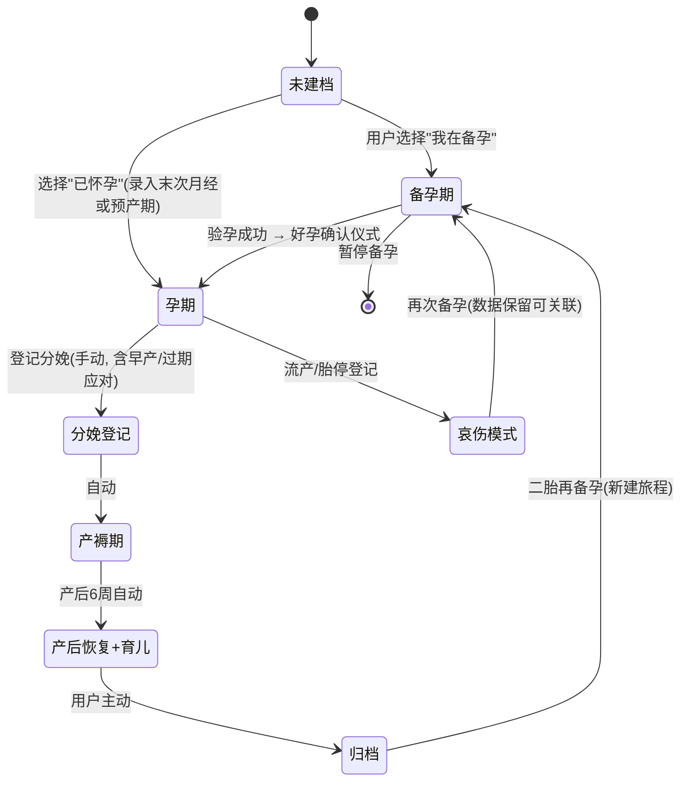

# 幸孕记（Lucky Bump）产品定位与功能架构

> 文档版本：v0.1
> 文档目的：定义产品定位、设计原则、整体功能架构、信息架构与"阶段引擎"——全产品的骨架。
> 关联文档：[01-需求分析报告](./01-需求分析报告.md) / [03-核心功能详细设计](./03-核心功能详细设计.md)

---

## 1. 产品定位

### 1.1 一句话定位

**「从备孕到育儿，一条不断档的生命记录」**——面向中国家庭的孕期全流程记录与健康管理工具。

### 1.2 价值主张

| 对象 | 价值主张 |
|---|---|
| 对妈妈 | 记录足够快、数据足够全、关键时刻（产检/临产/喂养）足够靠得住；你的 3 年孕育史就是一份完整的数据资产 |
| 对爸爸 | 一个给"参与者"设计的入口：今天该我做什么，一目了然 |
| 对家庭 | 孩子的第一份生命档案，从两道杠到三岁生日，一条连续的时间线 |
| 对自己（可持续） | 高迁移成本的数据资产 → 长生命周期 → 产品值得长期投入 |

### 1.3 命名与品牌（建议）

- 产品代号：**Lucky Bump**；中文名候选：**幸孕记**（推荐：谐音"幸孕"，"记"呼应记录核心）/ 好孕记 / 十月记。
- 品牌 tone：温暖、专业、克制。**视觉上避免幼态化堆砌，记录界面以中性信息设计为主，情感元素集中在仪式感场景**（好孕报、出生卡、年度报告）。

### 1.4 设计原则（全团队共识，评审时逐条对照）

1. **两步原则**：任何一条记录，从打开 APP 到完成 ≤ 2 步、≤ 5 秒；高频记录（亲喂、换尿布、胎动）提供计时器与一键模式。
2. **阶段感知**：全局只有一个"当前阶段"，首页、知识、待办都随阶段切换，用户永远不需要自己判断"我该看什么"。
3. **不诊断，给红线**：所有数据解读仅作参考；"红线提示"只做两件事——说清现象（如"收缩压 ≥ 140"）+ 建议动作（如"建议尽快就医"），绝不做"你可能得了 XX"的表述。
4. **隐私默认最小化**：敏感记录（同房、验孕、情绪、报告）默认仅本人可见；本地优先存储；分享动作永远二次确认。
5. **夜间单手可用**：产褥期深夜场景是核心场景，大点击区、暗色适配、免打扰时段默认开启（仅保留计时类被动信息，不做主动推送）。
6. **数据属于用户**：随时完整导出（PDF + JSON）、随时彻底删除，不设障碍。

---

## 2. 整体功能架构

```
幸孕记 Lucky Bump
│
├── ① 阶段引擎（产品脊柱）
│     建档 / 阶段状态机 / 孕周-月龄时钟 / 多宝宝档案 / 阶段切换仪式
│
├── ② 备孕（TTC）
│     经期周期 / 排卵预测与试纸 / 基础体温 BBT / 同房记录(隐私)
│     备孕健康打卡(叶酸等) / 孕前检查清单 / 验孕记录 / 好孕确认仪式
│
├── ③ 孕期（T1/T2/T3）
│     孕周首页(宝宝大小可视化) / 体重与增重区间 / 血压 / 血糖(GDM)
│     症状与情绪打卡 / hCG-孕酮翻倍 / 胎动计数 / 宫缩计时
│     孕期日记(图文) / 胎教打卡 / 待产包清单 / 临产指引 / 起名工具
│
├── ④ 产检中心
│     产检日程表(自动生成+可编辑) / 检查前准备提醒
│     产检记录(医院医生费用) / 报告拍照归档 / AI 报告识别与解读
│
├── ⑤ 分娩与产褥
│     临产指引(见红/破水/宫缩) / 分娩登记 / 恶露记录 / 伤口恢复
│     产后情绪自评(EPDS) / 盆底肌-凯格尔打卡 / 月子日程 / 42 天检查
│
├── ⑥ 育儿（0-36M+）
│     喂养(亲喂计时/瓶喂/奶粉/吸奶) / 尿布 / 睡眠(含小睡)
│     成长曲线(WHO 百分位) / 疫苗接种管理 / 儿保体检
│     里程碑(4 维度) / 辅食记录与忌口 / 用药记录 / 成长相册时光轴
│
├── ⑦ 数据中心
│     指标曲线 / 生命周期时间线 / 周报·阶段报告·年度报告(可分享)
│     数据导出(PDF/JSON) / 数据迁移与备份
│
├── ⑧ 家庭与隐私
│     家庭组(妈妈/爸爸/家人) / 爸爸端视图 / 权限模型
│     应用锁 / 敏感记录隐藏 / 免打扰时段
│
├── ⑨ AI 助手
│     报告识别 / 指标解读 / 口语化问答(场景化, 免责边界)
│
└── ⑩ 设置与数据管理
      隐私与安全 / 数据导出 / 关于与免责声明
```

架构说明：①②③④⑤⑥是业务层，按阶段由**阶段引擎**统一调度——同一套 Tab 框架在不同阶段呈现不同内容；⑦⑧是贯穿能力；⑨⑩是能力与管理层。

---

## 3. 信息架构与导航

### 3.1 底部导航（5 Tab，全阶段不变）

| Tab | 名称 | 内容 | 设计要点 |
|---|---|---|---|
| 1 | **今天** | 阶段化首页：孕周/月龄时钟、宝宝大小可视化、今日待办（产检提醒/该打卡的项）、快捷记录入口 | 用户 90% 的访问停留在此；信息密度克制，层级 ≤ 3 |
| 2 | **记录** | 快捷记录面板：按当前阶段动态给出记录项（孕期：体重/血压/胎动/宫缩…；产后：亲喂/瓶喂/尿布/睡眠…） | 高频项置顶；支持长按自定义排序；计时器类（宫缩/亲喂）全局悬浮 |
| 3 | **数据** | 全部指标的曲线视图 + 生命周期时间线 + 报告（周报/产检/成长/年度） | 从"记了"到"看见意义" |
| 4 | **知识** | 按"本周/本月该做什么"组织的阶段知识 + 症状查询 + 检查项目科普 | 不做信息流；内容以"解决当下问题"为粒度 |
| 5 | **我的** | 家庭组、宝宝档案、隐私与安全、设置、数据导出 | — |

### 3.2 核心页面地图

```
├─ 今天（阶段化首页）
│   ├─ 孕周大卡 / 月龄大卡
│   ├─ 今日待办（产检提醒、疫苗提醒、打卡项）
│   ├─ 快捷记录宫格（阶段动态）
│   ├─ 宝宝大小可视化卡（水果类比/身长体重）
│   └─ 家庭动态卡（爸爸今日打卡/留言）
├─ 记录
│   ├─ 快捷记录面板（宫格 + 自定义）
│   ├─ 计时器页：宫缩计时 / 亲喂计时 / 吸奶计时
│   ├─ 表单类记录页：体重/血压/血糖/症状/日记…
│   └─ 产检记录页（列表 → 详情 → 报告图集）
├─ 数据
│   ├─ 指标曲线（体重/血压/血糖/胎动/成长…）
│   ├─ 时间线（全生命周期，按日/周/月聚合）
│   └─ 报告中心（孕周周报/阶段报告/年度报告）
├─ 知识
│   ├─ 本周指南（孕周 × 内容）
│   ├─ 症状百科（症状 → 缓解 → 红线）
│   ├─ 检查项目库（每次产检查什么/怎么读）
│   └─ 忌口与安全清单
└─ 我的
    ├─ 宝宝档案（多宝宝管理）
    ├─ 家庭组（邀请/权限/移除）
    ├─ 隐私与安全（应用锁/敏感记录/免打扰）
    ├─ 设置 / 数据导出 / 关于与免责声明
```

---

## 4. 阶段引擎（产品脊柱）

### 4.1 阶段定义

| 阶段码 | 名称 | 区间 | 进入方式 |
|---|---|---|---|
| `PRECONCEPTION` | 备孕期 | 开始记录经期 → 验孕成功 | 用户自选或默认 |
| `T1` | 孕早期 | 孕 1-13 周（1-13+6） | 验孕成功确认 / 直接选择"已怀孕" |
| `T2` | 孕中期 | 孕 14-27 周 | 阶段时钟自动推进 |
| `T3` | 孕晚期 | 孕 28-40 周 | 阶段时钟自动推进 |
| `POSTPARTUM` | 产褥期 | 分娩后 0-6 周 | 分娩登记 |
| `RECOVERY` | 产后恢复期 | 产后 6 周-1 年 | 时钟自动推进 |
| `PARENTING` | 育儿期 | 0-36 月龄 | 与 RECOVERY 并行（产后恢复是妈妈视角，育儿是宝宝视角） |
| `ARCHIVED` | 归档 | — | 用户主动结束旅程 |

> 说明：产后阶段存在**双线并行**——妈妈的恢复线（恶露/情绪/盆底肌/体重）与宝宝的育儿线（喂养/成长/疫苗）。首页采用"她 + 宝宝"双卡设计，避免"生完宝宝，妈妈就从 APP 里消失了"这类常见问题。

### 4.2 状态机



### 4.3 孕周与预产期计算规则（关键规则，必须准确）

| 场景 | 计算方式 |
|---|---|
| 末次月经（LMP） | 预产期 = LMP + 280 天；孕周 = (今天 − LMP) 换算为"X 周 + Y 天" |
| 排卵日/同房受孕 | 预产期 = 排卵日 + 266 天 |
| IVF 试管 | 囊胚（D5）移植日 + 261 天（D3 卵裂胚 + 263 天）——按生殖中心口径可配置 |
| B 超校正 | 用户可录入 B 超推算孕周；**孕早期（≤ 13+6）CRL 最准，以最早的孕早期超声为最终校准**，此后录入不自动改写预产期，仅提示差异请用户确认 |
| 多胎 | 38 周即按"足月"对待（风险提示阈值整体前移） |
| 周边界 | 孕周展示统一为「N 周 + d」；月龄按自然月 + 天展示 |

### 4.4 阶段切换的关键设计

1. **好孕确认仪式**（备孕→孕期）：验孕记录为阳性后引导确认；生成「好孕报」分享图（隐藏敏感信息）；提示所有备孕数据将无缝带孕展示；同步邀请爸爸加入家庭组——**这是全产品最重要的一次转化与拉新时刻**。
2. **分娩登记**（孕期→产褥期）：支持顺产/剖宫产/助产；早产（<37 周）与过期（>42 周）不设为异常报错，而是差异化内容；多胎自动生成多个宝宝档案。
3. **哀伤模式**（流产/胎停）：一键隐藏所有宝宝相关内容与提醒（不删除数据）；首页替换为哀伤关怀内容（心理资源、复诊提醒、再次备孕引导）；**绝不推送任何孕育营销内容**。这是健康产品信任的分水岭，详见 03-M0。
4. **二宝回流**：归档/再备孕时新建"旅程"，历史旅程完整保留可查看；家庭组可直接复用。

---

## 5. 通用支撑能力（跨阶段）

| 能力 | 说明 | 详细设计 |
|---|---|---|
| 提醒引擎 | 规则类型：绝对日期 / 相对孕周 / 相对月龄 / 周期性打卡；统一免打扰时段；重要级别（如临产、疫苗）可突破免打扰 | 03-M9 |
| 家庭共享 | 角色：管理员(妈妈)/记录者(爸爸)/围观者(长辈)；只读或可记录可配置 | 03-M7 |
| 隐私与安全 | 应用锁（FaceID/密码）、敏感记录组、隐私清单页（谁看过什么） | 03-M7 |
| AI 助手 | 报告识别 / 指标解读 / 问答；统一免责声明组件 | 03-M8 |
| 数据中心 | 曲线、时间线、报告、导出 | 03-M6 |

---

## 6. 关键取舍记录（Decision Log）

| # | 决策 | 理由 | 放弃的方案 |
|---|---|---|---|
| D1 | 记录优先于社区 | 数据资产是留存基础；社区是资源黑洞 | 社区先行 |
| D2 | 单 APP 全阶段，而非多 APP 矩阵 | 数据连续性是核心卖点，拆开即失去 | 按阶段拆分子产品 |
| D3 | 产后"妈妈+宝宝"双线并行 | 同类产品普遍"生完只关心宝宝"，妈妈关怀是差异化口碑点 | 纯宝宝视角 |
| D4 | 5 Tab 固定框架、内容阶段化 | 降低阶段切换的学习成本 | 按阶段重排 Tab |
| D5 | 本地优先 + 云备份可选 | 健康数据信任底线；也降低早期云成本 | 云优先 |
| D6 | MVP 不做电商与社区 | 详见 01-§8 | 全功能铺开 |

---

*下一步阅读：[03-核心功能详细设计](./03-核心功能详细设计.md)*
